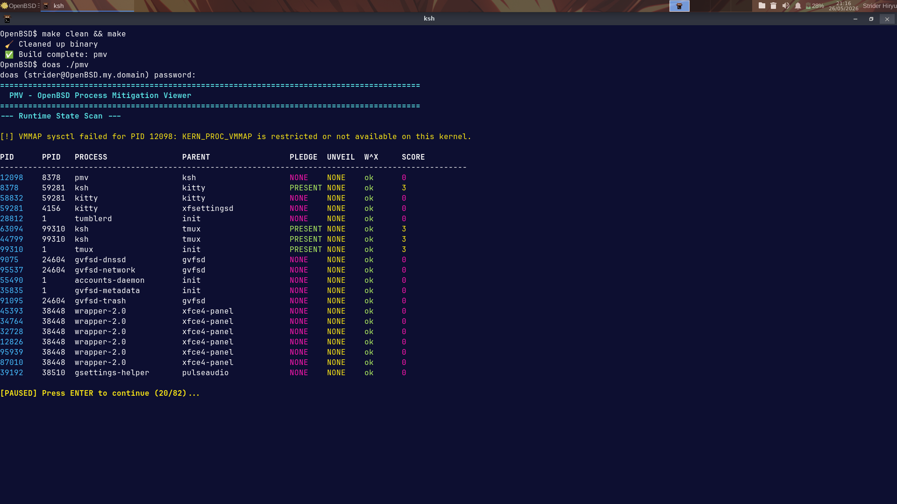
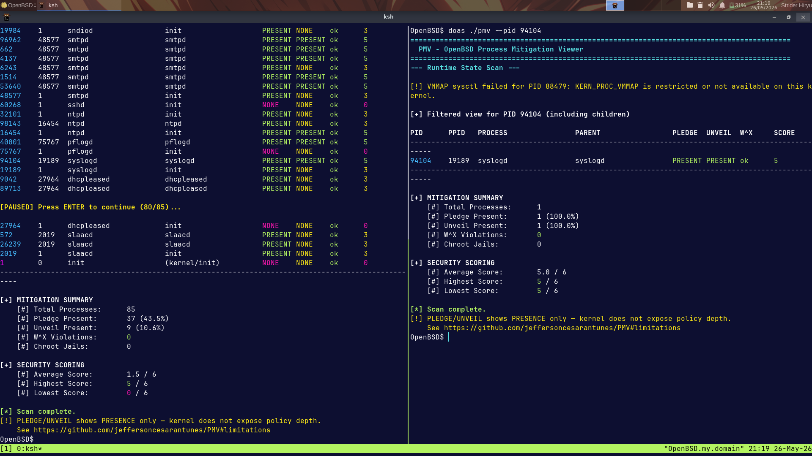
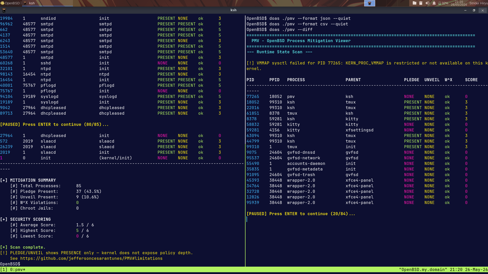

# PMV

Lightweight OpenBSD process mitigation visibility tool — inspects `pledge(2)`,
`unveil(2)`, and W^X state per process via `libkvm(3)`.

[](https://github.com/jeffersoncesarantunes/PMV/actions/workflows/ci.yml)
[](https://github.com/jeffersoncesarantunes/PMV/actions/workflows/codeql.yml)
[](LICENSE)
[](https://www.openbsd.org/80.html)

## Overview

PMV (**P**rocess **M**itigation **V**iewer) is a minimal utility for inspecting
process-level mitigation state on OpenBSD. It reads kernel-exposed process
metadata through `libkvm(3)` and `struct kinfo_proc` to report whether active
processes use `pledge(2)`, `unveil(2)`, and W^X policy.

All classification comes from kernel-reported state. PMV does not perform
runtime analysis, syscall tracing, or behavioral detection. It reports what the
kernel exposes — nothing more, nothing less.

PMV is intentionally not a replacement for `ktrace(1)`, `btrace(8)`, or other
OpenBSD introspection tools. The kernel exposes only whether `pledge(2)` and
`unveil(2)` were called, not which promises were made or which paths were
unveiled. That is a platform constraint, not a missing feature.

## Features

* Kernel process table inspection via `libkvm`
* `pledge(2)` and `unveil(2)` presence detection per process
* W^X-related indicators per process
* Per-process security scoring (-2 to 6)
* PID filtering (`--pid`) — inspect a single process and its children
* Parent process mapping (PPID)
* W^X memory region scan (`--scan-wx`)
* Self-hardening at runtime (`pledge` + `unveil`)
* Self-audit on startup (W^X integrity check)
* Structured export (JSON, CSV)
* Diff mode (`--diff`) — compare current state against a previous snapshot
* Silent mode (`--quiet`)

## Quick Start

```bash
git clone https://github.com/jeffersoncesarantunes/PMV.git
cd PMV && make
doas ./pmv
```

PMV requires `libkvm` and elevated privileges to access kernel memory. Run with
`doas` or as root.

## Usage

```bash
doas ./pmv               # Full system scan
doas ./pmv --help        # Usage reference
doas ./pmv --pid <PID>   # Filter by PID (show <PID> and its children)
doas ./pmv --diff        # Diff mode — compare against previous snapshot
doas ./pmv --scan-wx <PID>  # W^X memory scan with per-region detail
doas ./pmv --format json --quiet   # JSON export
doas ./pmv --format csv --quiet    # CSV export
```

### Example Output

```text
PID      PPID   PROCESS                PARENT                 PLEDGE  UNVEIL  W^X     SCORE
-----------------------------------------------------------------------------------------------------
89905    57770  pmv                    ksh                    PRESENT PRESENT ok      5
80996    57770  ksh                    xfce4-terminal         PRESENT NONE    ok      3
96837    1      xfce4-terminal         init                   NONE    NONE    ok      0
```

`PRESENT` confirms the mitigation syscall was called — it does not indicate
policy depth or scope. PIDs, process names, and scores vary by system and by
the privileges used to run PMV.

### Security Scoring

| Criteria | Value | Description |
| :------- | :---: | :---------- |
| `pledge(2)` called | +3 | Syscall restriction active |
| `unveil(2)` called | +2 | Filesystem restriction active |
| `chroot` jail | +1 | Additional filesystem containment |
| W^X violation (WXNEEDED) | -2 | Writable+executable memory pages |

| Score | Meaning |
| :---: | :------ |
| 4 – 6 | Multiple mitigations detected |
| 1 – 3 | Partial mitigation |
| ≤ 0 | No mitigations detected |

## How It Works

PMV uses `libkvm` to access the kernel process table in read-only mode. For each
process it reads `struct kinfo_proc` and checks:

* Whether `pledge(2)` was called (`p_psflags & PS_PLEDGE`)
* Whether `unveil(2)` was called (`p_psflags & PS_UNVEIL`)
* Whether W^X enforcement is active (`p_psflags & PS_WXNEEDED`)
* Whether the process is chrooted (`p_flag & P_CHROOT`)

## Project in Action







## Operational Integrity

* Read-only kernel access via `libkvm`
* No process interaction or `ptrace(2)` usage
* Self-hardened with `pledge(2)` and `unveil(2)` at runtime
* Graceful handling of restricted kernel entries

## Deployment

### Requirements

* OpenBSD (release or -current)
* `libkvm`
* BSD make
* `doas` or root privileges

### Privilege Model

`make install` places the binary without setuid root (`-m 755`), following
OpenBSD's philosophy of explicit privilege elevation rather than implicit
setuid escalation.

## Repository Structure

```text
├── docs/
│   ├── ARCHITECTURE.md
│   ├── BENCHMARKS.md
│   └── SECURITY_MODEL.md
├── Images/
│   ├── pmv-runtime-scan-v2.png
│   ├── pmv-pid-filter-v2.png
│   └── pmv-diff-audit-v2.png
├── include/
│   └── pmv.h
├── src/
│   ├── engine.c
│   └── main.c
├── man/
│   └── pmv.1
├── .clang-format
├── .editorconfig
├── .github/
│   ├── ISSUE_TEMPLATE/
│   ├── workflows/
│   └── PULL_REQUEST_TEMPLATE.md
├── .gitignore
├── CHANGELOG.md
├── CODE_OF_CONDUCT.md
├── CONTRIBUTING.md
├── LICENSE
├── Makefile
├── SECURITY.md
└── README.md
```

## Tech Stack

* **Language:** C (C11)
* **Kernel Interface:** libkvm
* **Data Source:** `struct kinfo_proc`
* **Build Tool:** BSD make
* **Platform:** OpenBSD

## Documentation

* [ARCHITECTURE.md](./docs/ARCHITECTURE.md)
* [SECURITY_MODEL.md](./docs/SECURITY_MODEL.md)
* [BENCHMARKS.md](./docs/BENCHMARKS.md)

## Security

See [SECURITY.md](./SECURITY.md) for the disclosure policy. Do not open public
issues for security vulnerabilities.

## Contributing

See [CONTRIBUTING.md](./CONTRIBUTING.md) for guidelines on reporting issues and
submitting pull requests.

## License

[MIT](LICENSE)
